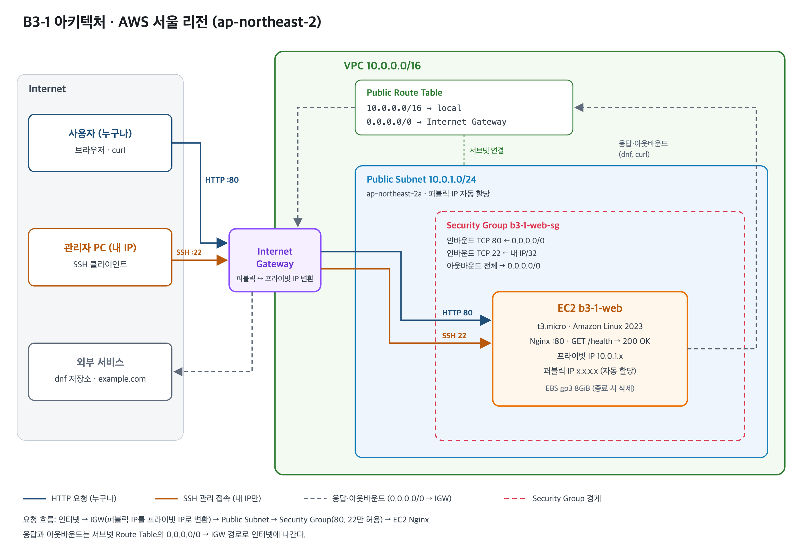

# B3-1 — 내가 만든 웹사이트를 인터넷에 올려 누구나 쓰게 하기

AWS 서울 리전(ap-northeast-2)에 VPC를 직접 만들고, Public Subnet의 EC2(Nginx)를 외부에 공개한다.
인프라는 Terraform으로 만들고 지운다. 실습용 IAM 사용자는 EC2/VPC 범위의 최소권한만 가진다.

## 외부 접속 검증 방식

**선택: (B) `GET http://<퍼블릭IP>/health` → `200 OK` + `OK`**

| 항목 | 값 |
| --- | --- |
| 헬스체크 URL | `http://<퍼블릭IP>/health` ← apply 후 기재 |
| 기대 응답 | `HTTP/1.1 200 OK`, 본문 `OK` |
| 증빙 | `docs/screenshots/external-health.png` |

## 디렉터리 구조

```text
.
├── README.md
├── terraform/
│   ├── versions.tf               # AWS 프로바이더, 리전, 공통 태그
│   ├── variables.tf              # 입력값: 내 공인 IP
│   ├── network.tf                # VPC, Internet Gateway, Subnet, Route Table
│   ├── security.tf               # Security Group
│   ├── compute.tf                # AMI, 키페어, EC2
│   ├── user_data.sh              # 첫 부팅 시 Nginx 설치, /health 설정
│   ├── outputs.tf                # 퍼블릭 IP, 헬스체크 주소, SSH 명령
│   └── terraform.tfvars.example
├── iam/
│   └── b3-1-least-privilege-policy.json
└── docs/
    ├── architecture.png          # 아키텍처 다이어그램 (원본 architecture.svg)
    ├── troubleshooting.md
    ├── cleanup-checklist.md
    └── screenshots/
```

## 아키텍처



| 구성 요소 | 값 | 역할 |
| --- | --- | --- |
| VPC | `10.0.0.0/16` | 다른 네트워크와 격리된 사설 네트워크 |
| Public Subnet | `10.0.1.0/24`, ap-northeast-2a | EC2가 놓이는 구역. 시작 시 퍼블릭 IP 자동 할당 |
| Internet Gateway | VPC에 연결 | VPC와 인터넷 사이 출입구 |
| Route Table | `0.0.0.0/0 → IGW` | 서브넷 밖으로 나가는 트래픽을 IGW로 보낸다. 이 경로가 있어야 Public Subnet |
| Security Group | 80 ← 전체, 22 ← 내 IP/32 | 인스턴스 앞의 방화벽 |
| EC2 | t3.micro, Amazon Linux 2023, gp3 8GiB | Nginx 웹 서버, `/health` 응답 |

**외부 요청이 EC2까지 도달하는 조건** 은 네 가지다. 하나라도 빠지면 접속이 안 된다.

1. 인스턴스에 퍼블릭 IP가 있다.
2. VPC에 IGW가 연결되어 있다.
3. 서브넷 Route Table에 `0.0.0.0/0 → IGW` 경로가 있다. 응답 패킷이 이 경로로 나간다.
4. Security Group이 해당 포트를 허용하고, 서버가 그 포트에서 대기 중이다.

## 보안 설계

**Security Group** 은 필요한 포트만 연다.

| 방향 | 포트 | 소스/대상 | 이유 |
| --- | --- | --- | --- |
| 인바운드 | TCP 80 | `0.0.0.0/0` | 누구나 웹 서비스를 써야 한다 |
| 인바운드 | TCP 22 | 내 공인 IP `/32` | 관리 포트라 나만 접속한다 |
| 아웃바운드 | 전체 | `0.0.0.0/0` | 패키지 설치(dnf)와 외부 통신 확인(curl) |

그 밖의 포트는 쓰지 않으므로 열지 않았다. 내 IP가 바뀌면 `terraform.tfvars`의 값을 고치고 `terraform apply`를 다시 실행한다.

**IAM** 은 "누가 무엇을 할 수 있는가"를, Security Group은 "어떤 트래픽이 들어오는가"를 통제한다.
실습용 사용자 `b3-1-user`에는 `iam/b3-1-least-privilege-policy.json`만 붙인다.

- 서울 리전의 EC2/VPC 작업만 허용한다.
- 조회는 읽기 전용 `ec2:Describe*`로 묶었다. Terraform이 리소스 상태를 확인할 때 여러 Describe API를 호출하기 때문이다.
- 변경 권한은 리소스 종류별로 묶어 나열했다: 네트워크(VPC·서브넷·IGW·라우트), 보안 그룹, 인스턴스·키 페어·태그.
  생성·삭제 외에 콘솔에서 인스턴스 중지/시작, 라우트·SG 규칙 수정을 할 수 있는 정도까지만 포함했다.
- `Deny` 문으로 t2.micro, t3.micro가 아닌 인스턴스 생성을 막는다. Allow보다 Deny가 우선하므로 실수로 큰 인스턴스를 띄워 과금되는 일을 막는다.
- S3, RDS, IAM 권한과 AdministratorAccess는 없다.
- CLI 자격 증명은 장기 액세스 키 대신 `aws login`의 임시 자격 증명을 쓴다.

## 사전 준비

### 1. 실습용 IAM 사용자 만들기 (루트 계정으로 최초 1회)

최소권한 사용자는 자기 자신을 만들 수 없으므로 이 단계만 루트로 한다. 이후에는 루트를 쓰지 않는다.

1. 루트로 콘솔에 로그인하고 루트 MFA를 켠다.
2. IAM → Policies → Create policy → JSON 탭에 `iam/b3-1-least-privilege-policy.json` 내용을 붙여넣는다. 이름은 `B3-1-LeastPrivilege`.
3. IAM → Users → Create user: 이름 `b3-1-user`, 콘솔 액세스를 허용한다.
4. Attach policies directly로 두 정책을 연결한다.
   - `B3-1-LeastPrivilege`: 실습에 필요한 EC2/VPC 권한
   - `SignInLocalDevelopmentAccess`: `aws login`용 AWS 관리형 정책. 로그인 권한만 있다.
5. 콘솔 로그인 URL을 기록하고 루트에서 로그아웃한다.

### 2. 도구 설치와 로그인

```bash
brew install awscli hashicorp/tap/terraform
aws login --profile b3-1 --region ap-northeast-2   # 브라우저에서 b3-1-user로 로그인
aws sts get-caller-identity --profile b3-1         # Arn이 ...:user/b3-1-user 인지 확인
```

로그인은 최대 12시간 유지된다. 만료되면 `aws login --profile b3-1`을 다시 실행한다.

### 3. SSH 키와 내 IP 설정

```bash
ssh-keygen -t ed25519 -f ~/.ssh/b3-1 -C "b3-1"   # 개인 키 ~/.ssh/b3-1 은 재발급 불가

cd terraform
echo "my_ip = \"$(curl -s https://checkip.amazonaws.com)/32\"" > terraform.tfvars
```

## 배포

```bash
cd terraform
terraform init
terraform plan      # Plan: 8 to add
terraform apply     # yes 입력
```

첫 부팅 때 Nginx를 설치하느라 1~2분 걸린다. 그 전에는 접속이 거부될 수 있다.

## 검증

```bash
IP=$(terraform -chdir=terraform output -raw public_ip)

# 1. SSH 접속 (내 IP에서만 가능)
ssh -i ~/.ssh/b3-1 ec2-user@$IP

# --- 인스턴스 안에서 ---
systemctl status nginx --no-pager        # active (running)
curl -i http://localhost                 # 200 OK
curl -sI https://example.com | head -1   # 아웃바운드 인터넷 확인
exit

# 2. 외부(내 PC)에서 (B) 검증
curl -i http://$IP/health
```

| 확인 항목 | 스크린샷 |
| --- | --- |
| SSH 접속 + `systemctl status nginx` | `docs/screenshots/ssh-nginx-status.png` |
| 인스턴스 내부 `curl localhost` 200, `curl example.com` 성공 | `docs/screenshots/internal-curl.png` |
| 외부에서 `GET /health` → 200 `OK` | `docs/screenshots/external-health.png` |
| 콘솔의 Route Table, Security Group 규칙 | `docs/screenshots/console-rt-sg.png` |

## 정리

```bash
terraform -chdir=terraform destroy   # yes 입력
aws logout --profile b3-1
```

삭제 확인 절차와 근거는 [docs/cleanup-checklist.md](docs/cleanup-checklist.md)에 남긴다.

## 비용 주의

- t3.micro와 EBS 8GiB는 프리 티어 범위다.
- 퍼블릭 IPv4 주소는 시간당 과금 대상이다. 실습이 끝나면 바로 destroy한다.
- NAT Gateway, Elastic IP, ALB, RDS는 만들지 않는다.

## 문서

- [트러블슈팅 보고서](docs/troubleshooting.md)
- [리소스 정리 체크리스트](docs/cleanup-checklist.md)
